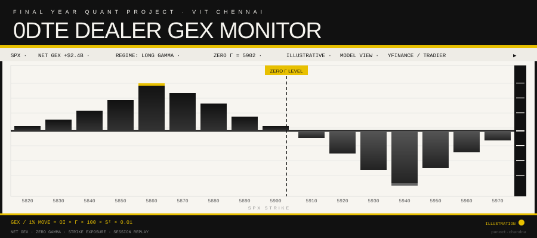

<p align="center">
  
</p>

# 0DTE Dealer Gamma Exposure (GEX) Monitor

<p align="center">
  <strong>Read the options landscape. Explore the session.</strong><br />
  Net GEX, zero gamma, strike exposure, and historical replay for SPX 0DTE options.
</p>

<p align="center">
  <code>SPX · 0DTE</code>&nbsp;&nbsp;
  <code>SQLite by default</code>&nbsp;&nbsp;
  <a href="LICENSE"><strong>Source-available</strong></a>
</p>

<p align="center">
  <a href="#features">Features</a> &nbsp;·&nbsp;
  <a href="#quick-start"><strong>Quick start</strong></a> &nbsp;·&nbsp;
  <a href="#configuration">Configuration</a> &nbsp;·&nbsp;
  <a href="#tests">Tests</a> &nbsp;·&nbsp;
  <a href="#documentation">Guides</a>
</p>

---

## Features

<table width="100%">
  <thead>
    <tr>
      <th align="left" scope="col">View</th>
      <th align="left" scope="col">What you can explore</th>
    </tr>
  </thead>
  <tbody>
    <tr>
      <td><strong>Gamma dashboard</strong></td>
      <td>Net GEX, zero gamma, exposure by strike, intraday history, and regime labels.</td>
    </tr>
    <tr>
      <td><strong>Analytics</strong></td>
      <td>IV surfaces, skew, and technical indicators alongside spot price.</td>
    </tr>
    <tr>
      <td><strong>Flow scenarios</strong></td>
      <td>Estimated hedging flows and scenario simulations.</td>
    </tr>
    <tr>
      <td><strong>Session replay</strong></td>
      <td>Captured sessions and historical backtests, with history separated by provider.</td>
    </tr>
  </tbody>
</table>

> [!NOTE]
> **Model-based signals. Provider-dependent data.** Yahoo Finance uses SPY options scaled by 10 as an SPX approximation. Configured Tradier can fetch SPX/SPXW options directly. Quote freshness varies by provider and API environment.

<details>
<summary><strong>Update timing and data interpretation</strong></summary>

WebSocket updates have a nominal five-second interval; fetch time and client
messages can change it. Current GEX REST polling is configurable (30 seconds by
default). These updates can continue outside market hours. Polling more often
does not guarantee fresher quotes.

Read the [dashboard guide](docs/UNDERSTANDING_GEX_DASHBOARD.md#data-delays-and-the-spy-proxy)
for provider caveats and interpretation limits.

</details>

---

## Quick Start

**Prerequisites:** Python **3.12+**, Node.js **20+** with **pnpm**, and
[Bash **5.1+**](https://lists.gnu.org/archive/html/info-gnu/2020-12/msg00003.html)
on Linux, macOS with a current Bash, or WSL.

**Native Windows?** Use the [PowerShell setup](docs/LOCAL_DEVELOPMENT.md#native-windows-powershell).
The Bash runner requires POSIX process groups, which native Windows Python does
not provide, including when started from Git Bash.

### 1. Clone

```bash
git clone https://github.com/puneet-chandna/0DTE-dealer-gamma.git
cd 0DTE-dealer-gamma
```

### 2. Install and configure

```bash
python3 -m venv backend/.venv
backend/.venv/bin/python -m pip install -r backend/requirements.txt
pnpm --dir frontend install --frozen-lockfile
./scripts/setup_env.sh
```

### 3. Start the session

```bash
./scripts/dev.sh
```

> [!TIP]
> **SQLite is ready by default.** The runner applies migrations and starts both services. The database file is `backend/odte_gex.db`; no database server or Docker setup is required.

**Open:** [Dashboard → localhost:3000](http://localhost:3000) ·
[API docs → localhost:8000/docs](http://localhost:8000/docs)

**Logs:** `.local-run/dev.log` &nbsp;·&nbsp; **Stop:** <kbd>Ctrl</kbd> + <kbd>C</kbd>
shuts down both services and their child processes.

---

## Configuration

Setup creates `backend/.env` and `frontend/.env.local` only when missing and
preserves existing settings.

**Configuration references:** [Backend template](backend/.env.example) ·
[Frontend template](frontend/.env.example)

<details>
<summary><strong>Enable Tradier</strong></summary>

Yahoo Finance is the default provider. Set `TRADIER_API_KEY` in `backend/.env`,
restart the backend, and choose Tradier in the provider selector.
Set `DATA_PROVIDER=tradier` to make it the backend default.

</details>

<details>
<summary><strong>PostgreSQL, environment overrides, and alternate startup</strong></summary>

Use the [local development guide](docs/LOCAL_DEVELOPMENT.md) for PostgreSQL,
environment overrides, native Windows, and separate terminals. For hosted setup,
follow the [deployment guide](docs/DEPLOYMENT.md).

</details>

---

## Tests

<details>
<summary><strong>Run lint, tests, and type checks</strong></summary>

Run these commands from the repository root after installing dependencies:

```bash
(cd backend && .venv/bin/python -m ruff check .)
(cd backend && .venv/bin/python -m pytest -q -m "not integration")
pnpm --dir frontend lint
pnpm --dir frontend test:run
pnpm --dir frontend exec tsc --noEmit
```

The backend and frontend test commands print coverage summaries. Live provider
checks use the backend `integration` marker and are separate from the deterministic
suite. See [development checks](docs/LOCAL_DEVELOPMENT.md#development-checks) for
additional commands.

</details>

---

## Documentation

<table width="100%">
  <thead>
    <tr>
      <th align="left" scope="col">When you want to…</th>
      <th align="left" scope="col">Open</th>
    </tr>
  </thead>
  <tbody>
    <tr><td><strong>Run locally</strong></td><td><a href="docs/LOCAL_DEVELOPMENT.md">Local development</a> · <a href="docs/LOCAL_DEVELOPMENT.md#native-windows-powershell">Windows setup</a></td></tr>
    <tr><td><strong>Read the signals</strong></td><td><a href="docs/UNDERSTANDING_GEX_DASHBOARD.md">Dashboard guide</a> · <a href="docs/ARCHITECTURE.md#gex-calculation-logic">GEX calculations</a></td></tr>
    <tr><td><strong>Explore the system</strong></td><td><a href="docs/ARCHITECTURE.md">Architecture</a> · <a href="docs/POSTGRES_SCHEMA.md">Database schema</a></td></tr>
    <tr><td><strong>Integrate or deploy</strong></td><td><a href="docs/API.md">API reference</a> · <a href="docs/DEPLOYMENT.md">Deployment guide</a></td></tr>
    <tr><td><strong>Check the evidence</strong></td><td><a href="docs/BENCHMARKS.md">Benchmarks</a> · <a href="docs/bugs.md">Bug tracker</a></td></tr>
    <tr><td><strong>Plan or contribute</strong></td><td><a href="docs/PROVIDER_INTEGRATION_PLAN.md">Remaining-work plan</a> · <a href="CONTRIBUTING.md">Contribution guide</a></td></tr>
  </tbody>
</table>

---

## License and Commercial Use

This project is `source-available`, not open source.

- Public license: [PolyForm Noncommercial 1.0.0](LICENSE)
- Ownership notice: [NOTICE](NOTICE)
- Commercial-use policy: [COMMERCIAL-LICENSING.md](COMMERCIAL-LICENSING.md)
- Commercial licensing contact: `puneetchandna21@gmail.com`

The public license allows personal study, research, testing, and other noncommercial uses
allowed by the license text. Commercial use, monetized services, business deployment,
commercial derivatives, and other revenue-generating use cases require a separate written
license from Puneet Chandna and Gunjana Sahoo.

---

## Contributing

Issues and pull requests are welcome. Contributions are submitted under the repository's
license terms, and no separate CLA is required.

See [CONTRIBUTING.md](CONTRIBUTING.md) for the workflow and contribution expectations.

---

## Security

Please report security vulnerabilities privately to `puneetchandna21@gmail.com` rather
than opening a public issue.

See [SECURITY.md](SECURITY.md) for reporting guidance and [SUPPORT.md](SUPPORT.md) for
general support routing.

---

**Built with love for quantitative traders and market structure enthusiasts.**
