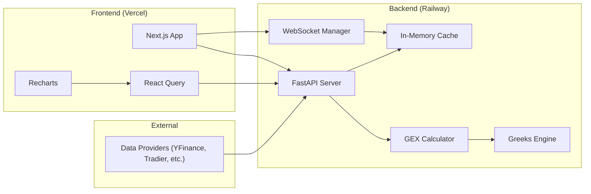
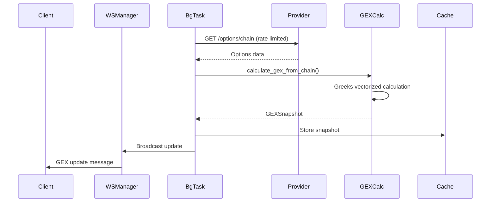
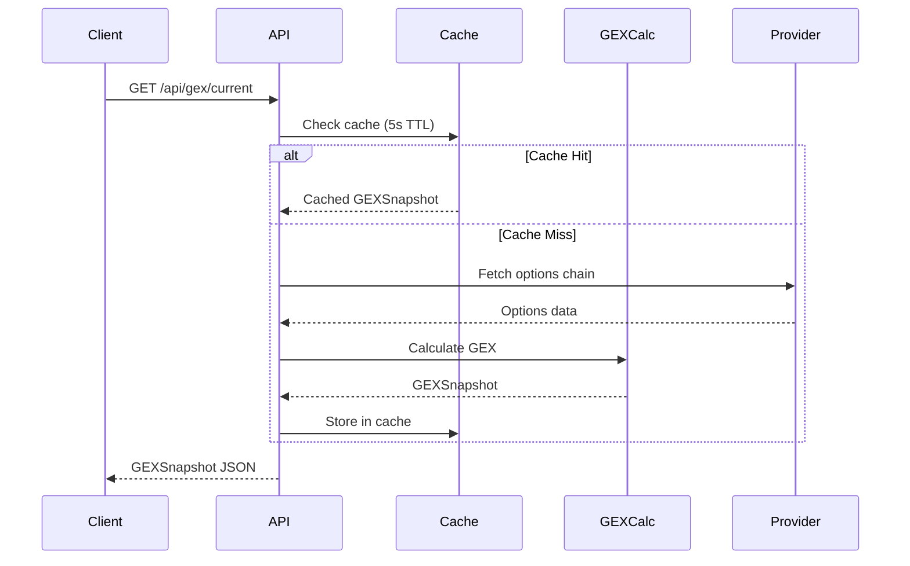

# Architecture

System design documentation for the 0DTE Dealer Gamma Exposure (GEX) Monitor.

## System Overview



## Component Architecture

### Backend (`/backend`)

| Component            | Path                           | Responsibility                        |
| -------------------- | ------------------------------ | ------------------------------------- |
| **FastAPI App**      | `app/main.py`                  | HTTP server, middleware, routing      |
| **Greeks Engine**    | `app/core/greeks.py`           | Vectorized Black-Scholes calculations |
| **GEX Calculator**   | `app/core/gex_calculator.py`   | GEX formula, zero gamma level         |
| **Data Providers**   | `app/core/base_provider.py`    | Dynamic unified data fetching via Registry |
| **Analytics**        | `app/core/analytics.py`        | Backtesting, volatility analysis      |
| **WebSocket**        | `app/api/websocket.py`         | Real-time streaming to clients        |
| **Cache**            | `app/services/cache.py`        | TTL-based in-memory caching           |
| **Background Tasks** | `app/services/background.py`   | Scheduled data fetching               |

### Frontend (`/frontend`)

| Component             | Path                        | Responsibility              |
| --------------------- | --------------------------- | --------------------------- |
| **Dashboard**         | `src/app/dashboard/`        | Main visualization page     |
| **GEX Charts**        | `src/components/charts/`    | Bar chart, time series      |
| **UI Components**     | `src/components/ui/`        | Cards, badges, metrics      |
| **API Client**        | `src/lib/api.ts`            | Typed Axios client          |
| **React Query Hooks** | `src/hooks/useGEXData.ts`   | Data fetching, polling      |
| **WebSocket Hook**    | `src/hooks/useWebSocket.ts` | Real-time updates           |
| **UI Store**          | `src/stores/uiStore.ts`     | Client-only state (Zustand) |

---

## Data Flow

### Real-Time GEX Calculation



### REST API Request



---

## State Management

### Server State (React Query)

- All API responses cached and managed by React Query
- Current GEX polling is configurable (30 seconds by default); regime polling defaults to 10 seconds. These frontend timers can continue outside market hours.
- Stale-while-revalidate pattern for instant UI
- Live current/regime caches reject older capture timestamps on both HTTP
  completion and WebSocket writes. Demo replay may move backward in time.
- Intraday live points must match the selected ET capture date. IV/technical
  queries refresh stale data on mount, focus and reconnect. Backtests fetch on
  explicit submission, including repeated or previously cached parameters.

### Client State (Zustand)

Only UI preferences stored in Zustand:

```typescript
interface UIState {
  alertThreshold: number; // GEX alert threshold
  selectedExpiration: string; // Selected date filter
  isSidebarOpen: boolean; // Sidebar visibility
  theme: "light" | "dark"; // Theme preference
}
```

> **Rule**: Never store API responses in Zustand. React Query is the single source of truth for server state.

---

## GEX Calculation Logic

### Formula

```txt
raw_gex_i = OI_i × Γ_i × 100 × S²
gex_i = raw_gex_i × 0.01
```

The calculator reports exposure for a 1% underlying move. Its Black-Scholes
gamma calculation uses an SPX dividend-yield default of `q = 0.015` from
[constants.py](../backend/app/core/constants.py).

- `OI` = Open Interest
- `Γ` = Black-Scholes Gamma (with dividend yield)
- `100` = Contract multiplier
- `S` = Spot price
- `0.01` = Conversion to a 1% underlying move

### Sign Convention

The trader-facing baseline in [gex_calculator.py](../backend/app/core/gex_calculator.py)
assigns positive exposure to calls and negative exposure to puts:

```txt
Net GEX = sum(Call GEX) + sum(Put GEX)
```

This is the application's modeling convention, not a measurement of actual
dealer positions.

### Zero Gamma Level

The calculator reprices aggregate gamma as spot varies within ±20% of observed
spot. Strike, expiry, open interest and each contract's implied volatility remain
fixed (sticky IV). Calls contribute positive signed inventory and puts negative;
this convention is an assumption, not observed dealer positioning. A bracketed
root solver chooses the nearest detected crossing. A finite scan can miss
pathological near-tangent roots. Without a detected crossing,
`zero_gamma_crossing_found=false`; the numeric spot fallback is never a verified
zero-gamma level. The UI displays “No root found.”

### Charm and vanna scenarios

Dollar hedge flow is `-signed_OI × 100 × (delta_after - delta_before) × spot`.
Charm uses a finite time step capped at expiry; vanna applies an absolute IV-point
bump per contract. Time uses 365.25-day years. Both scenarios hold spot and inventory
fixed. Their signs describe the assumed hedger's adjustment and are not measured
orders. `calculation_version=sticky_iv_delta_scenarios_v1` identifies this contract.

The Hawkes-style module is a snapshot imbalance heuristic. `squeeze_score` is an
uncalibrated score on [0, 1], never a probability; stored legacy
`squeeze_probability` payloads remain readable.

### Market Regimes

The default regime threshold is $1 billion of net GEX:

- Below −$1 billion: short gamma.
- Above +$1 billion: long gamma.
- Between those bounds, including the endpoints: neutral.

These labels summarize the computed exposure. See the
[dashboard guide](UNDERSTANDING_GEX_DASHBOARD.md) for interpretation and its limits.

---

## Security

### API Keys

- All secrets in environment variables (`.env`)
- Never committed to version control
- Configured dynamically via ProviderRegistry

### CORS

- Development: `http://localhost:3000`
- Production: Explicit whitelist of domains

### Rate Limiting

- YFinance: Dynamic throttling
- Tradier: Based on assigned tier
- Internal `RateLimiter` class enforces limits on a per-provider basis

---

## Performance

### Vectorization

All Greeks calculations use NumPy vectorization:

```python
# ✅ Correct: Vectorized (1000 contracts in ~0.5ms p50 — see docs/BENCHMARKS.md)
gamma = np.exp(-q * T) * norm.pdf(d1) / (S * sigma * np.sqrt(T))

# ❌ Wrong: Python loops (100x slower)
for i in range(len(contracts)):
    gamma[i] = calculate_single_gamma(contracts[i])
```

### Caching Strategy

| Data          | TTL | Invalidation    |
| ------------- | --- | --------------- |
| Current GEX   | 5s  | New calculation |
| Spot Price    | 1s  | Every tick      |
| Options Chain | 30s | Spot moves >1%  |

Spot baselines and move invalidation are scoped by provider and symbol. Default
options-chain keys also include the effective session date and reject expired
resolved fallbacks. Raw spot/chain responses retain capture times and label stale
fallbacks explicitly, with response-time age and market status.

Concurrent GEX producers share only their upstream fetch within a backend process;
each caller gets a private chain copy and retains its own calculation/persistence
work. Raw spot and options requests also share matching in-flight work. Canceling
one waiter does not cancel other callers; the last departing waiter cleans up the
task. This is process-local coordination, so separate workers have separate caches
and fetch tasks.

### Frontend Performance

- Charts wrapped in `React.memo()`
- Updates throttled to 200ms minimum
- Error boundaries prevent full-page crashes

---

## Deployment

```
┌─────────────────┐     ┌─────────────────┐
│    Vercel       │────▶│  Railway        │
│   (Frontend)    │     │  (Backend)      │
└─────────────────┘     └────────┬────────┘
                                 │
                        ┌────────▼────────┐
                        │   PostgreSQL    │
                        │   (Railway)     │
                        └─────────────────┘
```

See [DEPLOYMENT.md](./DEPLOYMENT.md) for setup instructions.
